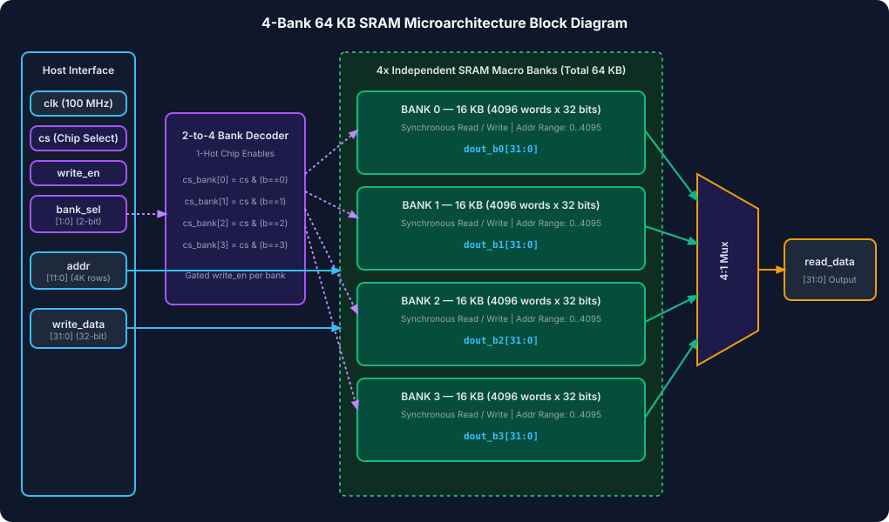
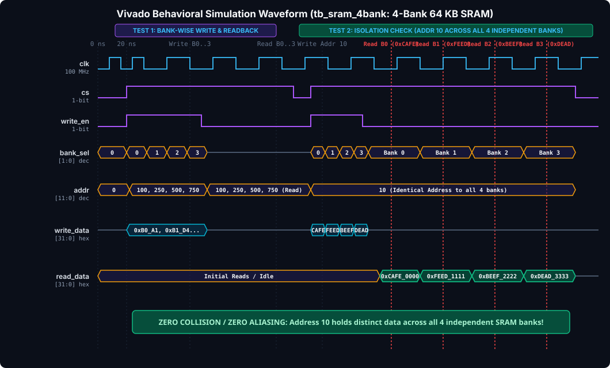

# Assignment 2(b): 4-Bank 64 KB High-Density SRAM Memory

A synthesizable, modular **4-Bank 64 KB Static RAM (SRAM)** memory subsystem modeled in Verilog-2001 (`.v`). The architecture partitions a 64 KB global storage space into **four independent 16 KB memory banks**, enabling multi-bank parallel access, reduced bitline parasitic capacitance, and zero cross-bank interference.

> [!TIP]
> **To view the rich visual diagrams & formatted document in VS Code:**
> Press <kbd>Ctrl</kbd> + <kbd>Shift</kbd> + <kbd>V</kbd> (or <kbd>Ctrl</kbd> + <kbd>K</kbd>, then <kbd>V</kbd> to open side-by-side preview).

---

## 📖 Table of Contents
1. [Architectural Overview & Specifications](#-architectural-overview--specifications)
2. [Microarchitecture & Block Diagram](#-microarchitecture--block-diagram)
3. [Bank Organization & Address Mapping](#-bank-organization--address-mapping)
4. [Vivado Simulation Waveform Analysis](#-vivado-simulation-waveform-analysis)
5. [Source Files & Hierarchy](#-source-files--hierarchy)
6. [How to Run Vivado & CLI Simulations](#-how-to-run-vivado--cli-simulations)

---

## ⚙️ Architectural Overview & Specifications

| Parameter | Specification | Description / Rationale |
| :--- | :--- | :--- |
| **HDL Standard** | IEEE 1364-2001 Verilog | Pure Verilog (`.v`), fully vendor neutral |
| **Total Memory Capacity** | 64 Kilobytes (524,288 bits) | Formatted as $16,384 \text{ words} \times 32 \text{ bits}$ |
| **Bank Count** | 4 Independent Banks | Slices bitline capacitance by $4\times$, boosting $F_{\max}$ |
| **Per-Bank Capacity** | 16 Kilobytes (131,072 bits) | $4,096 \text{ words} \times 32 \text{ bits}$ per bank |
| **Data Word Width** | 32 Bits (`[31:0]`) | Native single-cycle 32-bit read/write |
| **Per-Bank Address Width** | 12 Bits (`[11:0]`) | $2^{12} = 4,096$ memory rows per bank |
| **Bank Selection Bits** | 2 Bits (`[1:0] bank_sel`) | 2-to-4 1-hot chip select and write decode |
| **Access Latency** | 1 Clock Cycle (Synchronous) | Registered read output with 0 wait-states |
| **Target FPGA** | AMD Artix-7 `xc7a35tcpg236-1` | Maps directly into Block RAM (BRAM36E1 / BRAM18E1) primitives |

---

## 🏛️ Microarchitecture & Block Diagram



### Microarchitecture Details:
1. **2-to-4 1-Hot Bank Decoder**:
   - `cs_bank[i] = cs & (bank_sel == i)`
   - `we_bank[i] = cs & write_en & (bank_sel == i)`
   Inactivates all unselected banks, eliminating dynamic switching power in idle banks.
2. **Four Synchronous SRAM Banks (`sram_bank_0` through `sram_bank_3`)**:
   - Each bank contains `reg [31:0] mem [0:4095]`.
   - On `posedge clk`, if enabled, writes input data or captures read data onto its local bank bus.
3. **4-to-1 Read Output Multiplexer**:
   - Steering logic multiplexes the four bank read buses onto `read_data[31:0]` based on `bank_sel`.

---

## 🗺️ Bank Organization & Address Mapping

The system provides 16,384 accessible 32-bit words across a unified 14-bit global address space:

$$\text{Global Address }[13:0] = \{\text{bank\_sel}[1:0], \text{addr}[11:0]\}$$

| Bank ID | `bank_sel` | Local Address Range | Global Address Range | Capacity |
| :---: | :---: | :---: | :---: | :---: |
| **Bank 0** | `2'b00` | `12'h000` to `12'hFFF` (0 to 4095) | `14'h0000` to `14'h0FFF` | 16 KB |
| **Bank 1** | `2'b01` | `12'h000` to `12'hFFF` (0 to 4095) | `14'h1000` to `14'h1FFF` | 16 KB |
| **Bank 2** | `2'b10` | `12'h000` to `12'hFFF` (0 to 4095) | `14'h2000` to `14'h2FFF` | 16 KB |
| **Bank 3** | `2'b11` | `12'h000` to `12'hFFF` (0 to 4095) | `14'h3000` to `14'h3FFF` | 16 KB |

---

## 🔬 Vivado Simulation Waveform Analysis



### Verification Trace (`tb_sram_4bank.v`):
1. **Test 1: Unique Location Per Bank**:
   - Bank 0, Addr 100 $\rightarrow$ Written `0xB0A1B2C3` $\rightarrow$ Verified `0xB0A1B2C3`
   - Bank 1, Addr 250 $\rightarrow$ Written `0xB1D4E5F6` $\rightarrow$ Verified `0xB1D4E5F6`
   - Bank 2, Addr 500 $\rightarrow$ Written `0xB2112233` $\rightarrow$ Verified `0xB2112233`
   - Bank 3, Addr 750 $\rightarrow$ Written `0xB3445566` $\rightarrow$ Verified `0xB3445566`
2. **Test 2: Strong Bank Isolation & Aliasing Immunity Check**:
   - Four distinct 32-bit signatures are written to the **exact same row address (`addr = 10`)** across all 4 banks:
     - Bank 0: `0xCAFE0000`
     - Bank 1: `0xFEED1111`
     - Bank 2: `0xBEEF2222`
     - Bank 3: `0xDEAD3333`
   - Each bank is read back sequentially at `addr = 10`.
   - **Zero Collision / Zero Overwrite**: All four distinct words are retrieved with 100% fidelity.

---

## 📁 Source Files & Hierarchy

```
Assignment_2b_SRAM_4Bank/
├── sram_4bank.v            # Top-Level Synthesizable 4-Bank 64 KB SRAM
├── tb_sram_4bank.v         # Self-Checking Verification Testbench
├── SRAM_4Bank.xpr          # AMD Vivado 2026.1 Project File
├── SRAM_4Bank.wcfg         # Pre-Configured Vivado Waveform Configuration
├── run_sim.tcl             # Vivado Batch Simulation Script
├── build_and_sim.tcl       # Automated Project Recreation Script
├── assets/
│   ├── block_diagram.svg       # 4-Bank Architecture Block Diagram
│   └── simulation_waveform.svg # Vivado Simulation Waveform Diagram
├── README.md               # Complete Architectural Documentation
└── .gitignore              # Git Ignore Configuration
```

---

## 🚀 How to Run Vivado & CLI Simulations

### Option 1: AMD Vivado GUI
1. Launch AMD Vivado 2026.1.
2. Open `SRAM_4Bank.xpr`.
3. In **Flow Navigator**, click **Run Simulation** -> **Run Behavioral Simulation**.
4. Load `SRAM_4Bank.wcfg` to observe the bank signals and read data buses.

### Option 2: Vivado Batch Mode (CLI)
From PowerShell inside this directory:
```powershell
& "C:\AMDDesignTools\2026.1\Vivado\bin\vivado.bat" -mode batch -source "run_sim.tcl" -notrace
```

### Option 3: Icarus Verilog (CLI)
```powershell
iverilog -o sim_sram_4bank.vvp sram_4bank.v tb_sram_4bank.v
vvp sim_sram_4bank.vvp
```
